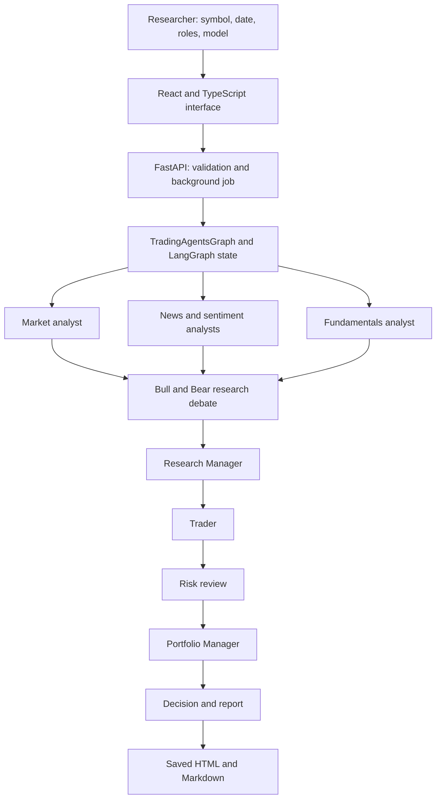

# TradingAgents MTech Project Guide

## What the project does

This project is a local research and paper-trading application built on the open-source TradingAgents framework. It lets a user inspect market history, ask a configurable set of LLM analyst agents to analyze a symbol, read the analyst and portfolio reports, and compare two analyst configurations on the same historical cases. It is not a brokerage application and does not place live orders.

The MTech research question is: **Does adding news and fundamentals analysts to a market-only analyst configuration change rating-weighted benchmark-relative outcomes on matched Indian-equity cases?** The current saved experiment is a three-case RELIANCE.NS pilot. Treat its results as exploratory.

## How a normal analysis runs

1. The researcher enters a symbol, analysis date, analyst roles, model, and tool-call limit in the React interface (or uses the CLI).
2. The interface sends a request to the local FastAPI service. The service validates the symbol/model/limits and queues one LLM job so shared vendor configuration is not changed by concurrent runs.
3. `TradingAgentsGraph` creates the workflow state and builds a LangGraph. The selected specialist analysts run in parallel. Each has its own message history and can call only its configured tools.
4. Analyst tools obtain price/indicator, news, social, macro, prediction-market, or fundamental evidence through the configured vendor router. The analysis date is passed to dated tools to prevent later information from leaking into a historical run. The selected Gemini model produces the language and decisions; the model does not itself verify every sentence.
5. The Bull and Bear researchers debate the analyst findings. A Research Manager summarizes them, a Trader proposes a plan, risk agents challenge it, and the Portfolio Manager returns the final rating/decision.
6. The completed state is saved. The report writer produces per-role Markdown, a consolidated Markdown file, and a standalone HTML report. No live order is submitted.

### Workflow at a glance



The analysts use provider tools for evidence; those sources are outside this graph's control. A report must say when a feed was unavailable, and a missing feed must not be described as proof that no event happened.

## How the research experiment differs from one analysis

The Research Study page runs two configurations, A and B, over the same ticker/date cases. A is market-only; B is market, news, and fundamentals. For each saved recommendation, the project settles the later historical price outcome against the mapped regional benchmark. It then pairs the same ticker/date under A and B, applies the rating exposure weights, calculates the paired difference and uncertainty summaries, and saves experiment metadata, case rows, and a comparison report. Rescoring a saved run reads the logs and does not make a Gemini call; price retrieval is only needed if an outcome is still unsettled.

The weighted score is a signal proxy: Sell -1, Underweight -0.5, Hold 0, Overweight +0.5, Buy +1, multiplied by realized benchmark-relative alpha. It is not a backtested portfolio return. The current pilot has n=3; do not claim significance, equivalence, or predictive profitability from it.

## Starting the application on Windows

Start the API in one PowerShell window:

```powershell
Set-Location "D:\AIML Project\TradingAgents"
.\.venv\Scripts\python.exe -m uvicorn api_server:app --host 127.0.0.1 --port 8000
```

Start the React development server in a second window:

```powershell
Set-Location "D:\AIML Project\TradingAgents\frontend"
npm run dev
```

Open the Vite URL printed in the terminal, normally `http://127.0.0.1:5173`. The API serves the production build on `http://127.0.0.1:8000` after `npm run build`. Keys belong in the ignored `.env`; never paste them into the README, screenshots, or source files.

## Important files and what each one owns

### User interface and local API

| File | Responsibility |
|---|---|
| `frontend/src/App.tsx` | Four UI areas (Markets, Agent Analysis, Research Study, Reports), form state, market charts, job polling, and result presentation. |
| `frontend/src/api.ts` | Typed browser-side API requests and report/experiment download URLs. |
| `frontend/src/styles.css` | Layout, components, responsive rules, and light/dark theme colors. Theme choice is saved in browser local storage. |
| `frontend/vite.config.ts` | Local frontend development server and API proxy configuration. |
| `frontend/package.json` | React build/development commands and UI/chart dependencies. |
| `api_server.py` | FastAPI routes, request validation, job queue, market/search data, experiment execution, report listing, rescoring, and static frontend serving. |
| `main.py` | Small direct Python example that initializes a graph and runs one ticker; the normal interface entry point is FastAPI/React. |
| `cli/main.py` | Typer command-line application and subcommand registration. |
| `cli/run.py` | Interactive CLI analysis flow and report display/save behavior. |

### Agent workflow and model calls

| File | Responsibility |
|---|---|
| `tradingagents/graph/trading_graph.py` | Main graph facade: configuration, model construction, propagation, streaming, run metadata, memory, and report saving. |
| `tradingagents/graph/setup.py` | Constructs the LangGraph nodes and edges for analysts, research debate, trader, risk debate, and portfolio manager. |
| `tradingagents/graph/analyst_execution.py` | Determines which selected analysts run and how they are scheduled. |
| `tradingagents/graph/conditional_logic.py` | Routes debate and risk steps according to round limits and speakers. |
| `tradingagents/graph/propagation.py` | Creates the initial shared state and LangGraph invocation settings. |
| `tradingagents/agents/state.py` | Typed state fields exchanged across the agent graph (reports, decisions, history, and context). |
| `tradingagents/agents/analysts/market_analyst.py` | Market analyst instructions and calls to price/indicator tools. |
| `tradingagents/agents/analysts/news_analyst.py` | News and macro analyst instructions and source tools. |
| `tradingagents/agents/analysts/fundamentals_analyst.py` | Company fundamentals analysis role. |
| `tradingagents/agents/analysts/sentiment_analyst.py` | Social/sentiment analysis role. |
| `tradingagents/agents/researchers/bull_researcher.py`, `bear_researcher.py` | Construct the bullish and bearish research arguments. |
| `tradingagents/agents/managers/research_manager.py` | Synthesizes the debate into the investment plan. |
| `tradingagents/agents/trader/trader.py` | Converts the plan into a trading proposal. |
| `tradingagents/agents/risk_mgmt/` | Conservative, neutral, and aggressive risk review roles. |
| `tradingagents/agents/managers/portfolio_manager.py` | Produces the final portfolio decision and rating. |
| `tradingagents/agents/tools.py` | Tool definitions exposed to agents; validates dates and routes requests to data providers. |
| `tradingagents/llm_clients/factory.py` | Selects and creates an LLM provider client from configuration. |
| `tradingagents/llm_clients/google_client.py` | Google Gemini provider integration used in this project. |

### Market data, scoring, and output

| File | Responsibility |
|---|---|
| `tradingagents/dataflows/router.py` | Routes each data tool to its explicitly configured vendor chain and standardizes unavailable/error responses. |
| `tradingagents/dataflows/config.py` | Makes vendor/model configuration available within each run. |
| `tradingagents/dataflows/vendors/yahoo/` | Yahoo Finance price, OHLCV, news, market-snapshot, and fundamentals adapters. |
| `tradingagents/dataflows/vendors/sec_edgar.py` | SEC filing/fundamentals data adapter where supported. |
| `tradingagents/dataflows/vendors/fred.py` | FRED macro data adapter (requires its own API key). |
| `tradingagents/memory/log.py` | Stores prior recommendations and realized outcomes for context/evaluation. |
| `tradingagents/memory/settlement.py` | Fetches historical outcomes and resolves the benchmark used for settlement. |
| `tradingagents/backtest.py` | Runs historical decision grids and records case-level recommendation/outcome logs. |
| `tradingagents/compare.py` | Pairs matched backtest cases, computes rating-weighted outcomes, intervals/tests, HTML report, and CSV. |
| `tradingagents/reporting.py` | Writes agent sections, coverage notes, consolidated Markdown, and standalone HTML. |
| `tradingagents/report_html.py` | Renders the print-friendly offline report, data-source notes, rating summary, and cached price/SMA SVG chart. |
| `tradingagents/default_config.py` | Default model, debate, tool, cache, results, memory, and vendor settings. |
| `README.md` | Project quick start, CLI help, configuration, and upstream documentation. |
| `docs/PROJECT_STATUS.md` | Current implementation state, saved measured results, and remaining research work. |
| `docs/DEMO_RUNBOOK.md` | Clean-start demo sequence and viva preparation prompts. |
| `research-paper/main.tex` | Editable LaTeX research manuscript source. |

## Where generated files go

- `.tradingagents-data/results/reports/`: saved report folders and report HTML/Markdown.
- `.tradingagents-data/results/backtest/`: saved run logs and outcome records.
- `.tradingagents-data/results/experiments/`: paired experiment metadata, comparison report, and CSV.
- `.tradingagents-data/cache/`: data provider cache used for tools and static report charts.
- `.tradingagents-data/memory/`: recommendation and outcome memory.
- `.env`: local secrets; ignored by Git and must remain private.

Generated market data and model reports are not automatically ground truth. Before using a statement in the paper, check the source, date, unit, and whether a feed actually returned data.
